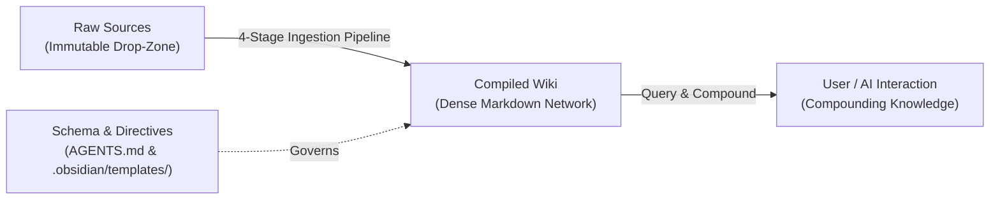

# 🧠 Elmu Library
**`Harness-Agnostic Knowledge Library based on Karpathy LLM Wiki`**

A persistent, compounding personal knowledge base built on the **Andrej Karpathy LLM Wiki Pattern**.

Instead of performing query-time retrieval against unorganized document dumps, an AI assistant continuously compiles, interlinks, and maintains a structured, dense Markdown wiki grounded in immutable primary sources. Repository directives live in [AGENTS.md](AGENTS.md), templates live in [.obsidian/templates/](.obsidian/templates/), and `wiki/` remains strictly pure compiled knowledge.

---

## 📂 Repository Architecture

```
.
├── AGENTS.md                 # Harness-agnostic compiler directives & operating rules
├── README.md                 # Human usage guide & repository overview
│
├── 🧠 wiki/                   # Pure Compiled Knowledge Base (Dense Markdown Network)
│   ├── index.md              # Master domain navigation hub (7 domain catalogs)
│   ├── log.md                # Chronological append-only compiler operations ledger
│   ├── <domain>/             # Compiled domain articles, <domain>-index.md & concept hubs
│   └── archive/              # Historical, point-in-time archived snapshots
│
├── 📥 raw/                    # Immutable Primary Sources (Grounding Tier)
│   ├── README.md             # Raw source drop-zone specification & naming conventions
│   ├── <topic>/              # Domain-specific primary sources (YYYY-MM-DD-slug.md/.pdf/.txt)
│   └── assets/               # Downloaded images (Obsidian attachment folder)
│
├── 🧩 .obsidian/              # Obsidian vault settings, plugins & note templates
│   └── templates/            # Canonical templates (article, concept-hub, raw, index, archive)
│
├── ⚡ scripts/                # Automated verification tooling (pure Python stdlib)
│   ├── verify_all.py         # Unified runner executing all three verification checks
│   ├── check_frontmatter.py  # Validates 7-field frontmatter, version syntax & blockquote sync
│   ├── lint_wiki.py          # Checks wikilinks (incl. raw/), orphans, red links, concept hubs & log
│   └── check_evidence.py     # Mechanical evidence check enforcing the Grounding Invariant
│
└── 🧪 tests/                  # Automated unit & regression tests (pure Python unittest)
    └── test_scripts.py       # Test suite for verification scripts
```

---

## 🧭 Core Pattern & Operations



1. **The Grounding Invariant**: Every load-bearing factual claim in `wiki/` (specific numbers, dates, direct quotes) must exist verbatim in an immutable source file under `raw/`.
2. **4-Stage Ingestion Pipeline**:
   - **Fetch**: Store raw document in `raw/<topic>/YYYY-MM-DD-slug.md` (or `.pdf`/`.txt`) with provenance metadata (`.obsidian/templates/raw-template.md`).
   - **Triage & Version Gate**: Search `wiki/` for existing related topics. Confirm `version` (and optional `bundle_version` when the source bundle differs from the subject component); the agent stops and asks if ambiguous.
   - **Compile**: Synthesize dense, structured markdown notes at `wiki/<domain>/<slug>.md` with 7-field YAML frontmatter and `[[wikilinks]]`. When $\ge 2$ divergent versions exist (`<slug>-v<ver>.md`), maintain an unversioned **Concept Hub** (`<slug>.md`, `version: "meta"`).
   - **Log**: Append a canonical entry in `wiki/log.md` recording the operation.
3. **Query & Compound**: Read `wiki/index.md`, drill into compiled notes, and file valuable cross-source syntheses back into `wiki/` as permanent notes.
4. **Lint & Maintain**: Periodically verify frontmatter, links, unindexed pages, log formatting, and grounding fidelity.

### Ingest Modes
| Mode | When to use | Tradeoff |
|---|---|---|
| **Incremental** _(recommended)_ | One source at a time; review LLM output before proceeding | Higher quality steering; slower throughput |
| **Batch** | Multiple sources in one pass with less supervision | Faster; less control; suited for trusted domain sources |

---

## 📥 Source Capture & Obsidian Workflows

### Web Articles — Obsidian Web Clipper
1. Install the **Obsidian Web Clipper** browser extension.
2. Convert any article to clean markdown and save to `raw/<topic>/YYYY-MM-DD-slug.md` with provenance headers from `.obsidian/templates/raw-template.md` (`Source`, `Collected`, `Published`, `Version`).

### PDFs, Documents & Transcripts
- Save PDFs to `raw/<topic>/YYYY-MM-DD-slug.pdf` (or `.txt` if converted) alongside a companion `raw/<topic>/YYYY-MM-DD-slug-provenance.md` with provenance headers.
- Export transcripts/podcasts to `raw/<topic>/YYYY-MM-DD-slug.md` with episode `Published:` and capture `Collected:` dates.

### Image Handling (`raw/assets/`)
1. Obsidian is pre-configured with `attachmentFolderPath: "raw/assets"` in `.obsidian/app.json`.
2. In Obsidian Settings → Hotkeys, bind **"Download attachments for current file"** (e.g. `Ctrl+Shift+D`) to pull remote clipped images into `raw/assets/`.
3. When ingesting, have the AI read the markdown text first and inspect referenced images separately.

### Dataview & Marp Queries
Use **Dataview** (`dataview` plugin) to query frontmatter dynamically without manual lists:

```dataview
TABLE version, updated, summary
FROM "wiki"
WHERE file.name != "index" AND file.name != "log"
SORT updated DESC
LIMIT 20
```

```dataview
TABLE updated, summary
FROM "wiki"
WHERE version = "meta" AND !contains(file.name, "-index")
SORT file.name ASC
```

For slide presentations synthesized from wiki queries, use **Marp** (`marp-slides` plugin) with `marp: true` frontmatter and `---` slide separators.

---

## 🛠️ Verification & Test Tooling

Run the entire verification suite with one command:

```bash
python3 scripts/verify_all.py .
```

Or run individual checks and the unit test suite:

```bash
python3 scripts/check_frontmatter.py .
python3 scripts/lint_wiki.py .
python3 scripts/check_evidence.py .
python3 -m unittest discover -s tests -v
```
